<!--
  YOGISHWAR · MOTOVERSE — glass-chrome game profile
  All numbers come from public GitHub data (data/github-snapshot.json + live cards). Art is original.
-->

<a href="https://github.com/yogishwar09">
  <picture>
    <source media="(max-width: 600px)" srcset="assets/motorcycle/hero-mobile.png" />
    
  </picture>
</a>

  

<picture>
  <source media="(prefers-color-scheme: dark)" srcset="https://raw.githubusercontent.com/yogishwar09/yogishwar09/output/github-snake-dark.svg" />
  <source media="(prefers-color-scheme: light)" srcset="https://raw.githubusercontent.com/yogishwar09/yogishwar09/output/github-snake.svg" />
  
</picture>

  
  

