<!--
  YOGISHWAR · MOTOVERSE
  Black superbike · black-clad rider · night circuit · neon-green GitHub contributions.
  Every number here comes from GitHub (data/github-snapshot.json), refreshed by
  .github/workflows/update-profile.yml. Nothing is invented.
-->

<a href="https://github.com/yogishwar09">
  <picture>
    <source media="(max-width: 600px)" srcset="assets/motorcycle/hero-mobile.png" />
    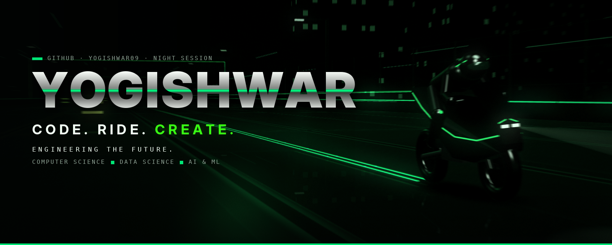
  </picture>
</a>

<picture>
  <source media="(prefers-reduced-motion: reduce)" srcset="assets/motorcycle/rider-background.png" />
  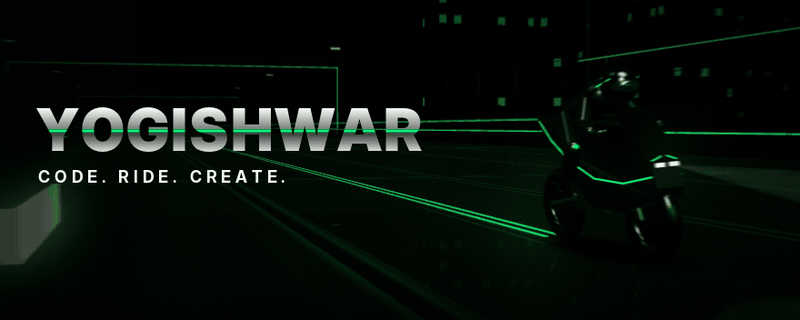
</picture>

<!-- ─────────────── THE CONTRIBUTION CIRCUIT ─────────────── -->



<picture>
  <source media="(prefers-reduced-motion: reduce)" srcset="assets/contributions/contribution-terrain.png" />
  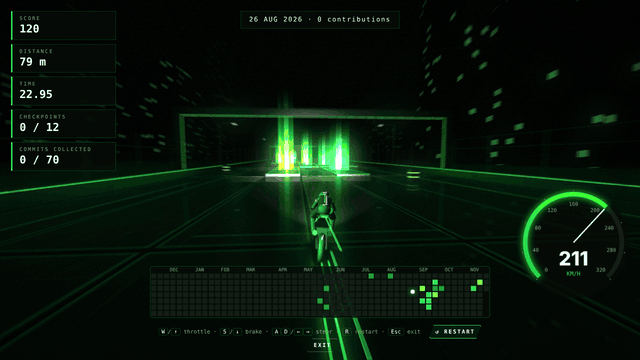
</picture>

  <b>Play it:</b> the Motoverse game lives in <a href="game/index.html"><code>game/</code></a> — open <code>game/index.html</code> in a desktop browser.
  &nbsp;·&nbsp; <i>A live link goes here once the experience is published.</i>

<!-- ─────────────── RIDER PROFILE ─────────────── -->



  
   
  
  
  

<!-- ─────────────── FEATURED PROJECTS ─────────────── -->

<a href="https://github.com/yogishwar09/AI-Interview-Trainer-Pro"></a>

<a href="https://github.com/yogishwar09/ai-customer-retention-platform-"></a>

<a href="https://github.com/yogishwar09/golden-hour"></a>

<!-- ─────────────── GITHUB TELEMETRY ─────────────── -->

  


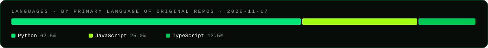


<!-- ─────────────── CONNECT ─────────────── -->

  
  

